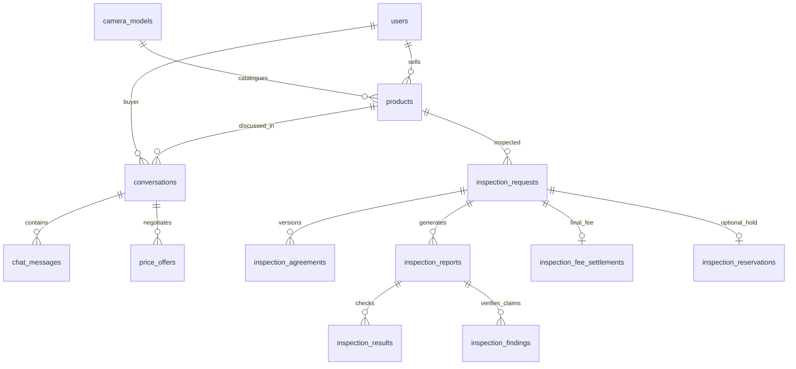
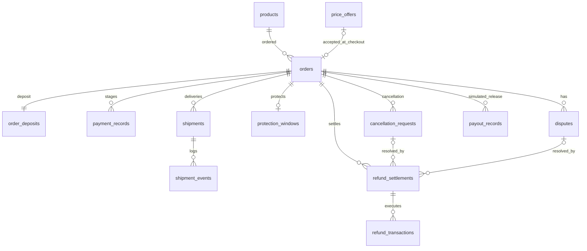

# CameraHub v3.2 — Logical ERD

The physical schema (`001_full_schema.sql`) is authoritative. These diagrams emphasize the most important relationships; other lookup, media, audit, and event tables are present in the SQL.

## Marketplace and inspection

## Orders, deposit, shipping and disputes

## Monetary semantics
- `orders.agreed_price_vnd`: mutually accepted listed/offer price.
- `orders.shipping_fee_vnd`: buyer-paid shipping quote locked at checkout or accepted before second payment.
- `orders.total_vnd`: generated `agreed_price_vnd + shipping_fee_vnd`.
- `orders.deposit_amount_vnd`: generated 10% of price, rounded to integer VND.
- `payment_records`: one successful simulated payment for DEPOSIT and one for BALANCE_AND_SHIPPING; retries may exist.
- `inspection_fee_records`: advance record; `inspection_fee_settlements`: final liability, not a cash transfer.
- `refund_settlements` and `refund_transactions`: decision vs. execution.
